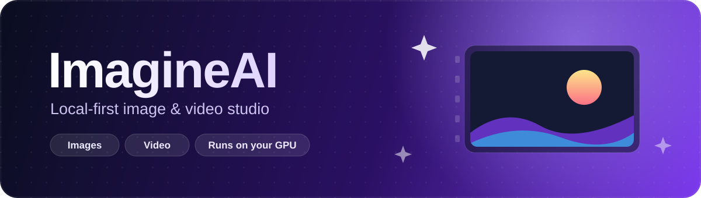
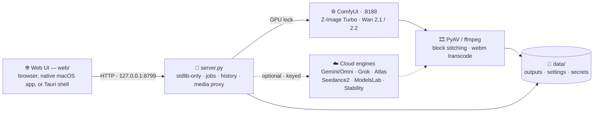

<div align="center">



**A local-first image & video studio.** Your GPU does the work — the cloud is optional, invited by API key only.

<br>


<br>

<a href="#-quick-start">Quick&nbsp;Start</a> ·
<a href="#-feature-tour">Features</a> ·
<a href="#-engine-matrix">Engine&nbsp;Matrix</a> ·
<a href="#-long-form-video">Long-Form&nbsp;Video</a> ·
<a href="#-architecture">Architecture</a> ·
<a href="#-desktop-app">Desktop</a> ·
<a href="#-configuration">Configuration</a> ·
<a href="#-troubleshooting">Troubleshooting</a> ·
<a href="#-safety--privacy">Privacy</a>

</div>

---

> [!IMPORTANT]
> **This is the macOS edition of ImagineAI.** It tracks the current feature set from `main`—including **Gemini Omni** in the Video tab—and adds a native Swift/WKWebView app, a working macOS image picker, and a one-command installer under `macos/`.

ImagineAI is a clean, fast creative cockpit that doesn't send every prompt to a cloud service by default. A **single-file, standard-library-only** Python server (`server.py`) serves a lightweight web UI, drives your local **ComfyUI** install, and keeps settings, keys, and generated media on your machine.

Generate and edit stills with **Z-Image Turbo**, render text-to-image with **FLUX.1 Schnell Q4/GGUF or FP8**, render text-to-video and image-to-video with **Wan 2.1 / Wan 2.2** — and when the GPU is busy, optionally reach for **Gemini, Gemini Omni, Grok Imagine, Atlas Cloud, Seedance2.ai, ModelsLab, or Stability AI**.

## ⚡ Quick Start

For the native macOS app:

```bash
./macos/install-macos-app.sh
open ~/Applications/ImagineAI.app
```

You can later double-click `Launch ImagineAI.command` from Finder. The installer records the repository location in the app bundle, so the checkout does not need to live in a hard-coded folder.

For the browser version:

```bash
cd ~/imagineai
./start.sh
```

Then open **http://127.0.0.1:8799** — or run the server directly:

```bash
python3 server.py --port 8799 --open
```

**You need:**

- Python 3 — that's it for the server (no `pip install`, ever)
- A ComfyUI checkout (normally `~/ComfyUI`) with the model files used by the bundled local workflows. The native Mac wrapper starts it automatically on `http://127.0.0.1:8188` when needed.
- *Optional:* Node.js + npm, only for the [Tauri desktop build](#-desktop-app)
- *Optional:* API keys for any [cloud engine](#-engine-matrix) you want to enable

## 🎨 Feature Tour

- 🖥️ **Local-first generation** — images via ComfyUI's Z-Image Turbo or auto-detected FLUX.1 Schnell Q4/FP8 workflows; video via Wan 2.2 14B, Wan 2.2 TI2V 5B, or Wan 2.1 1.3B
- 🎬 **Long-form local video** — clips up to **120 s**, rendered as blocks and stitched locally, plus a WanVideoWrapper single-pass path
- 🔗 **Seamless multi-segment cloud video** — Atlas, Grok, and Google segments chain from the previous segment's last frame (image-to-video), use supported continuity controls, and every seam is crossfaded so the result flows as a single clip
- 🎛️ **Advanced video controls** — a collapsible panel in the Video tab with a **negative prompt**, a **seed** field, and an **ElevenLabs soundtrack** prompt, wired through to the engines that support them
- 🎧 **ElevenLabs soundtracks** — describe music or ambience and it is composed to match the video's length and mixed under any native audio (the video stream is remuxed untouched)
- 🎭 **Director mode** — one film of up to **3 minutes**: the idea is planned as scenes (via Gemini 3.8 Flash when configured), each scene picks its engine by content — **Wan gets the artistic freedom, Grok tolerates a little, Google video handles the safe shots** — and everything chains and crossfades into a single clip
- ✏️ **Reference-image editing** — upload an image in the Image tab and edit with local Z-Image, Gemini, Grok Imagine, or Atlas
- 🎞️ **Multiple start images** — in the Video tab: Grok Imagine blends them into one clip; local Wan 2.2 travels through them as keyframes
- ☁️ **Six optional cloud engines** — every key stored locally in `data/secrets.json`, never committed
- 🧵 **Background jobs & history** — generations run as jobs with live status; results land in a local gallery
- 🔀 **Media proxying & model detection** — ComfyUI media served through same-origin endpoints; installed models detected automatically
- 🔐 **GPU lock** — image and video jobs never fight over the same VRAM at the same time
- 🪟 **Browser UI + desktop app** — same interface in your browser or a Tauri v2 shell

## Model refresh — October 26, 2026

The current defaults are Nano Banana 2.1 for Google images, Gemini Omni 1.1 Flash for Google video, Gemini 3.8 Flash for Director planning, Grok Imagine Image 2.0 / Video 1.5, Atlas Seedream 5.0 Pro / Wan 3.0, and Seevio Seedance 2.5. Known previous saved defaults migrate when loaded and on the next settings save. Custom model IDs remain configurable; the retired Gemini Pro preview maps to its Pro successor. Local ComfyUI model files and hardware-specific workflows are unchanged.

Sources: [Google models](https://ai.google.dev/gemini-api/docs/models), [Google retirements](https://ai.google.dev/gemini-api/docs/deprecations), [Omni API](https://ai.google.dev/gemini-api/docs/omni), [xAI image migration](https://docs.x.ai/developers/migration/imagine-image-quality-nov-2), [xAI video API](https://docs.x.ai/developers/model-capabilities/video/generation), [Atlas Seedream](https://www.atlascloud.ai/docs/more-models/bytedance/seedream-v5.0-pro-text-to-image/generateImage), [Atlas Wan 3.0](https://www.atlascloud.ai/docs/more-models/alibaba/wan-3.0-text-to-video/generateVideo), [Seevio API](https://seevio.ai/api-docs), [Sora retirement](https://developers.openai.com/api/docs/deprecations).

ModelsLab SDXL/Wan 2.2 and Stability Core keep their existing defaults. ModelsLab's newer Wan 2.7 requires a separate v7 adapter and input controls; it is not silently routed through the existing v6 integration. This update is covered by local request-contract and regression tests; paid generation and account-specific model access have not been exercised.

## 🧩 Engine Matrix

| Engine | 🖼️ Images | 🎥 Video | ✏️ Reference edit | 🎞️ Start image(s) | Max clip | Key |
|---|:---:|:---:|:---:|:---:|---|---|
| **Z-Image Turbo** — local · ComfyUI | ✅ | — | ✅ | — | — | — |
| **FLUX.1 Schnell FP8** — local · ComfyUI | ✅ | — | — | — | — | — |
| **Wan 2.1 / 2.2** — local · ComfyUI | — | ✅ | — | ✅ multiple → keyframes | 120 s stitched | — |
| **Google Gemini Image** | ✅ | — | ✅ | — | — | `GEMINI_API_KEY` |
| **Google Gemini Video** | — | ✅ native audio | — | ✅ first image only | 60 s stitched (chained + crossfaded) | `GEMINI_API_KEY` |
| **xAI Grok Imagine** | ✅ | ✅ | ✅ | ✅ multiple → blended mix | 60 s stitched (chained + crossfaded) | `XAI_API_KEY` |
| **Atlas Cloud** — Wan 3.0 / Seedream 5.0 Pro / custom models | ✅ | ✅ | ✅ via edit model | ✅ first image only | 60 s stitched (chained + crossfaded) | `ATLAS_API_KEY` |
| **Gemini Omni** — Omni 1.1 Flash via the Gemini API | — | ✅ native audio | — | ✅ first image only | 60 s stitched (chained + crossfaded) | `GEMINI_API_KEY` |
| **OpenAI Sora** — retired September 24, 2026 | — | unavailable | — | — | — | retained for existing settings |
| **ElevenLabs** — soundtrack for any video | — | 🎧 music/ambience mixed in | — | — | up to 10 min composed | `ELEVENLABS_API_KEY` |
| **Seevio / Seedance 2.5** | 🟡 still frames | ✅ | — | — | 30 s per call | `SEEDANCE_API_KEY` |
| **BytePlus ModelArk / Seedance 2.5** | — | ✅ native audio | — | ✅ first image only | 30 s per call | `BYTEPLUS_API_KEY` / `ARK_API_KEY` |
| **ModelsLab / Stable Diffusion API** | ✅ | ✅ `wan2.2` / `wan2.6-t2v` | — | — | 120 s (~5 s segments, stitched) | `MODELSLAB_API_KEY` |
| **Stability AI** — `core` / `sd3` / `ultra` | ✅ | — | — | — | — | `STABILITY_API_KEY` |

**How the uploads behave:**

- **Reference images (Image tab)** — wired for local Z-Image Turbo, Gemini, Grok Imagine, and Atlas. Atlas switches to a dedicated image-to-image edit model (default `bytedance/seedream-v5.0-pro/edit`). Seedance, ModelsLab, and Stability stay text-to-image; if a reference is attached, the UI asks you to pick a supported edit engine.
- **Start images (Video tab)** — add up to 8. Grok Imagine **mixes** them all into one clip; local Wan 2.2 TI2V 5B / 14B use them as **keyframes in order**; Atlas and BytePlus use the **first image only**. BytePlus accepts the uploaded image directly and follows its aspect ratio. Seevio and ModelsLab remain text-to-video here.
- **Seedance still frames** — the Image tab uses Seevio's video endpoint with `return_last_frame` enabled and saves the returned last frame as a still. This consumes Seevio video credits, independently of the selected Seedance video provider.

## 🎬 Long-Form Video

**Local (up to 120 s)** — the Wan 14B model can't render two minutes in one pass on a small GPU, so ImagineAI has two strategies:

1. **Block renderer** — the clip is generated as short blocks; a lossless PNG of each block's last frame (grabbed inside ComfyUI, *before* H.264 compression) seeds the next block as image-to-video, so continuity holds without artifacts compounding into mush. Blocks that hit an out-of-memory error are automatically retried at a smaller length, then everything is stitched into one file.
2. **WanVideoWrapper path** — if kijai's WanVideoWrapper custom node (plus its umt5 encoder) is installed, the Wan 2.2 TI2V 5B model runs with block-swap streaming transformer blocks through system RAM — fitting on 8 GB VRAM — and keeps one long clip coherent in a **single pass**, no stitching needed.

**Cloud (up to 60 s for Atlas, Grok, and Google; 30 s for Seedance; 120 s for ModelsLab)** — the current Atlas Wan 3.0 and Seedance 2.5 models support native clips up to 30 seconds. Grok uses up to 15-second segments, and Google uses 4/6/8-second segments. Longer Atlas, Grok, and Google clips chain from the previous segment's final frame and are crossfaded locally with their audio. Seed controls are offered only where supported; Gemini Omni accepts exclusions through the normal prompt instead of a separate negative-prompt field. Legacy explicitly configured models retain their provider-specific request formats.

**Sora is retired.** OpenAI shut down its Videos API on September 24, 2026, with no replacement. The Sora choice is disabled and new requests return an explanatory error before making any cloud call; existing history and stored credentials are retained.

**Director mode (up to 3 minutes)** — the 🎭 Director model plans your idea as consecutive scenes (Gemini writes the scene prompts and tags each one `safe`/`mild`/`free` when a key is configured; a keyword heuristic acts as a floor either way). Each scene is routed to a **cloud engine** by that tag: **free/artistic scenes go to Atlas' Wan 3.0**, **mild ones to Grok**, and **safe ones to Google video**. The Director **never renders on local Wan** — if every available engine refuses a scene, the job stops with the scene prompt so you can render that part yourself with the model of your choice (the local Wan chips have no content filter). Scenes chain from each other's last frame — even across engines — with an unchained retry per engine before falling through to the next. Everything is stitched into one crossfaded film with audio, tunable via `IMAGINEAI_DIRECTOR_MAX_SECONDS` and `IMAGINEAI_DIRECTOR_PLANNER_MODEL`.

**Soundtracks (ElevenLabs)** — with an `elevenlabs` key saved, the Video tab's Advanced panel gains a soundtrack prompt. After any video finishes (cloud or local), ImagineAI composes matching music/ambience via the Eleven Music API (falling back to the sound-effects endpoint on free plans, looped to length), and mixes it into the mp4 master: original audio stays on top, the music sits under it as a bed, and the video stream is remuxed untouched. A failed soundtrack never fails the video job.

**Stitching & playback** — segments are joined with a **crossfade at every seam** (default 0.5 s, tune or disable with `IMAGINEAI_STITCH_OVERLAP_SECONDS`), which also swallows the duplicated frame that chaining introduces. The stitched master is a **high-quality H.264 mp4 that keeps the segments' audio** (equal-power crossfaded over the same window as the video; x264 CRF 16 / preset slow — tune with `IMAGINEAI_STITCH_MP4_CRF` / `IMAGINEAI_STITCH_MP4_PRESET`) and is what the download button serves. A **VP9 + Opus webm** is derived from it for inline playback (Linux webkit2gtk webviews usually lack an H.264 decoder). Everything runs through **PyAV in ComfyUI's Python environment**, with an **ffmpeg fallback** (xfade-based when clip durations can be probed, video-only) resolved from `IMAGINEAI_FFMPEG` / `FFMPEG_BINARY` / `FFMPEG`, your `PATH`, the bundled `node_modules/ffmpeg-static`, or common install locations.

## 🧠 Architecture



Everything flows through `server.py`: it serves the UI, drives ComfyUI workflows, polls cloud providers, proxies media through same-origin endpoints, and stitches video segments locally.

## 💻 Desktop App

### Native macOS edition

The Mac branch includes `macos/ImagineAI.swift`. Its WKWebView wrapper starts the local Python server, starts and monitors ComfyUI when installed at `~/ComfyUI`, opens a native app window, and implements the macOS open panel required by the reference/start-image controls. Set `IMAGINEAI_COMFYUI_PATH` when the checkout lives elsewhere.

```bash
./macos/install-macos-app.sh
```

This builds and ad-hoc signs `~/Applications/ImagineAI.app`. Requirements are macOS 12 or newer, Python 3, and the Xcode command-line tools (`xcrun swiftc`). Re-run the command after changing the Swift wrapper.

### Cross-platform Tauri shell

Node.js is only needed for the Tauri build. Install the tooling once, then:

```bash
npm install            # once
npm run desktop:dev    # Tauri v2 shell in development
npm run desktop:build  # build a desktop package
```

The Tauri build step prepares `desktop-dist/` from the web app. Build output and generated packages are git-ignored.

## 🔧 Configuration

Everything is configurable from **Settings** inside the app: ComfyUI URL, default image engine, Gemini image model + key, xAI image/video models + key, Atlas image/video models, Seedance video model, ModelsLab image/video models (shown when a ModelsLab key is saved), Stability image model (`core`, `sd3`, or `ultra`, shown when a Stability key is saved), and other named API keys for future providers or local helper scripts. FLUX selects Q4/GGUF when its loader and split model files are present, with FP8 as a fallback. The GGUF path uses FP32 compute and memory-conscious output sizes for stable Apple Silicon rendering.

Secrets live in `data/secrets.json` with restrictive permissions where supported — the file is git-ignored. Saved keys other than the built-in providers are shown as masked status hints; unknown provider names are kept for future integrations.

| Provider | Settings key aliases | Env override |
|---|---|---|
| Google Gemini | dedicated field | `GEMINI_API_KEY` |
| Gemini Omni (Google video) | uses the Gemini key | `GEMINI_API_KEY` |
| OpenAI Sora (retired; existing keys only) | `sora` · `openai` | `OPENAI_API_KEY` / `SORA_API_KEY` |
| xAI Grok Imagine | dedicated field | `XAI_API_KEY` |
| Atlas Cloud | `atlas` · `atlascloud` · `atlas-cloud` | `ATLAS_API_KEY` / `ATLASCLOUD_API_KEY` |
| Seevio (formerly Seedance2.ai) | `seevio` · `seedance` · `seedance2` · `seedance2-ai` | `SEEVIO_API_KEY` / `SEEDANCE_API_KEY` / `SEEDANCE2_API_KEY` |
| BytePlus ModelArk | dedicated field · `byteplus` · `modelark` · `ark` | `BYTEPLUS_API_KEY` / `ARK_API_KEY` |
| ModelsLab | `sdxl` · `modelslab` · `stable-diffusion-api` · `free-api` · `vrije-api` · `wan2.6-t2v` | `MODELSLAB_API_KEY` |
| Stability AI | `stability` · `stability-ai` | `STABILITY_API_KEY` |
| ElevenLabs | `elevenlabs` | `ELEVENLABS_API_KEY` |

> [!TIP]
> Atlas environment variables take **precedence** over saved keys — useful when switching from an Atlas Coding Plan token to a full Atlas Cloud API key.

<details>
<summary><strong>🌍 Environment variables</strong> — full reference</summary>

### Server

| Variable | Default | Purpose |
| --- | --- | --- |
| `IMAGINEAI_HOST` | `127.0.0.1` | HTTP bind host |
| `IMAGINEAI_PORT` | `8799` | HTTP port |
| `IMAGINEAI_DATA_DIR` | `./data` | Local settings, secrets, and outputs |
| `IMAGINEAI_VERBOSE` | empty | Enable verbose request logging |

### ComfyUI & local video

| Variable | Default | Purpose |
| --- | --- | --- |
| `COMFYUI_URL` | `http://127.0.0.1:8188` | ComfyUI base URL |
| `IMAGINEAI_COMFYUI_PATH` | `~/ComfyUI` | ComfyUI checkout auto-started and monitored by the native Mac wrapper |
| `COMFY_PYTHON` | `~/ComfyUI/.venv/bin/python` | ComfyUI venv Python (has PyAV) used for stitching/transcoding |
| `COMFYUI_INPUT_DIR` | `~/ComfyUI/input` | ComfyUI input folder for uploaded images and seed-frame handoff |
| `IMAGINEAI_FLUX_CHECKPOINT` | `flux1-schnell-fp8.safetensors` | FLUX Schnell FP8 fallback checkpoint |
| `IMAGINEAI_FLUX_GGUF_UNET` | `flux1-schnell-Q4_K_S.gguf` | Preferred FLUX Schnell GGUF diffusion model |
| `IMAGINEAI_FLUX_GGUF_T5` | `t5-v1_1-xxl-encoder-Q4_K_S.gguf` | GGUF T5 text encoder |
| `IMAGINEAI_FLUX_CLIP_L` | `clip_l.safetensors` | FLUX CLIP-L text encoder |
| `IMAGINEAI_FLUX_VAE` | `ae.safetensors` | FLUX autoencoder |
| `IMAGINEAI_IMAGE_TIMEOUT` | `600` | Local image job timeout (seconds) |
| `IMAGINEAI_VIDEO_TIMEOUT` | `3600` | Local video job timeout (seconds) |
| `IMAGINEAI_MISSING_HISTORY_GRACE` | `25` | Grace period before a missing ComfyUI history entry counts as failed |
| `IMAGINEAI_LOCAL_MAX_SECONDS` | `120` | Cap for local Wan long-form clips |
| `IMAGINEAI_WAN_BLOCK_SECONDS` | `10` | Target length of each rendered block |
| `IMAGINEAI_WAN_MIN_BLOCK_SECONDS` | `5` | Smallest block length when retrying after OOM |
| `IMAGINEAI_WAN_MAX_DIMENSION` | `576` | Longest-edge cap so the 14B model fits on a small GPU |
| `IMAGINEAI_WAN_MIN_DIMENSION` | `192` | Floor on render dimensions |
| `IMAGINEAI_WAN_CLIP_DEVICE` | `cpu` | Where the ~5 GB umt5-xxl text encoder loads (`default` = GPU) |
| `IMAGINEAI_WAN_CLEAN_SEED_FRAME` | `1` | Seed continuation blocks with a lossless pre-H.264 PNG (`0` = ffmpeg frame grabs) |
| `IMAGINEAI_WANVIDEO_BLOCK_SWAP` | `20` | WanVideoWrapper block-swap depth (0–40) |
| `IMAGINEAI_WANVIDEO_STEPS` | `25` | WanVideoWrapper sampling steps (1–60) |
| `IMAGINEAI_WANVIDEO_T5` | `umt5-xxl-enc-fp8_e4m3fn.safetensors` | kijai umt5 encoder (WanVideoWrapper rejects the Comfy fp8_scaled one) |
| `IMAGINEAI_STITCH_OVERLAP_SECONDS` | `0.5` | Crossfade length at every segment seam when stitching (0–2 s; `0` = hard cut) |
| `IMAGINEAI_STITCH_MP4_CRF` | `16` | x264 quality of the stitched mp4 master (lower = better, 0–51) |
| `IMAGINEAI_STITCH_MP4_PRESET` | `slow` | x264 preset for the stitched mp4 master (`slow` = best quality per bit) |
| `VEO_VIDEO_MODEL` | `gemini-omni-1.1-flash` | Google video model; existing setting name retained, Omni uses the Interactions API |
| `VEO_RESOLUTION` | `720p` | Omni resolution: `360p`, `720p`, `1080p`, or `4k`; legacy Veo limits apply to explicitly configured Veo IDs |
| `SORA_VIDEO_MODEL` | `sora-2` | Legacy setting only — API retired Sep 24, 2026; generation disabled |
| `ELEVENLABS_MUSIC_MODEL` | server default | Optional Eleven Music model override (e.g. `music_v2`) |
| `IMAGINEAI_FFMPEG` / `FFMPEG_BINARY` / `FFMPEG` | auto-detect | Explicit ffmpeg binary; otherwise `PATH`, bundled `ffmpeg-static`, or common install paths |

### Google Gemini

| Variable | Default | Purpose |
| --- | --- | --- |
| `GEMINI_API_KEY` | empty | Gemini key for cloud image generation |
| `GEMINI_IMAGE_MODEL` | `gemini-nano-banana-2.1` | Gemini image model |

### xAI Grok Imagine

| Variable | Default | Purpose |
| --- | --- | --- |
| `XAI_API_KEY` | empty | xAI key for Grok Imagine image/video |
| `XAI_IMAGE_MODEL` | `grok-imagine-image-2.0` | xAI image model |
| `XAI_VIDEO_MODEL` | `grok-imagine-video-1.5` | xAI video model |
| `XAI_BASE_URL` | `https://api.x.ai/v1` | xAI API base URL |
| `IMAGINEAI_XAI_IMAGE_TIMEOUT` | `600` | xAI image request timeout (seconds) |
| `IMAGINEAI_XAI_VIDEO_TIMEOUT` | `1200` | xAI video polling timeout (seconds) |

### Atlas Cloud

| Variable | Default | Purpose |
| --- | --- | --- |
| `ATLAS_API_KEY` / `ATLASCLOUD_API_KEY` | empty | Atlas Cloud key for image/video generation |
| `ATLAS_IMAGE_MODEL` / `ATLASCLOUD_IMAGE_MODEL` | `bytedance/seedream-v5.0-pro/text-to-image` | Atlas Cloud image model |
| `ATLAS_IMAGE_EDIT_MODEL` | `bytedance/seedream-v5.0-pro/edit` | Atlas image-to-image model used for reference edits |
| `ATLAS_VIDEO_MODEL` / `ATLASCLOUD_VIDEO_MODEL` | `alibaba/wan-3.0/text-to-video` | Atlas Cloud text-to-video model |
| `ATLAS_I2V_MODEL` / `ATLASCLOUD_I2V_MODEL` | `alibaba/wan-3.0/image-to-video` | Atlas Cloud image-to-video model used when a start image is attached |
| `ATLAS_WAN30_RESOLUTION` | `1080p` | Wan 3.0 resolution: `480p`, `720p`, `1080p`, or an ESR variant |
| `ATLAS_WAN30_AUDIO` | `true` | Generate native audio with Wan 3.0 |
| `ATLAS_WAN30_SEED` | `-1` | Wan 3.0 seed; `-1` chooses a random seed |
| `ATLAS_WAN27_RESOLUTION` | `1080P` | Atlas Wan 2.7 resolution (`720P`, `1080P`, `1080P-SR`, or `1440P-SR`) |
| `ATLAS_WAN27_AUDIO` | empty | Optional Wan 2.7 soundtrack URL (`wav` or `mp3`) |
| `ATLAS_WAN27_PROMPT_EXTEND` | `true` | Enables Atlas prompt enhancement for Wan 2.7 |
| `ATLAS_WAN27_SEED` | `-1` | Wan 2.7 seed, with `-1` for random |
| `ATLAS_MODERATION_RETRIES` | `2` | Extra retries when Wan 2.7's output moderation false-positives (0–5) |
| `ATLAS_BASE_URL` / `ATLASCLOUD_BASE_URL` | `https://api.atlascloud.ai/api/v1` | Atlas Cloud API base URL |
| `IMAGINEAI_ATLAS_IMAGE_TIMEOUT` | `600` | Atlas image polling timeout (seconds) |
| `IMAGINEAI_ATLAS_VIDEO_TIMEOUT` | `1200` | Atlas video polling timeout (seconds) |

### Seedance: BytePlus ModelArk or Seevio

In **Settings → Seedance video provider**, choose the service that issued your key. A key from [BytePlus ModelArk](https://ai.byteplus.com/ark/region:ap-southeast-1/apiKey) belongs in the dedicated **BytePlus ModelArk API key** field. Select **BytePlus ModelArk** and use model `dreamina-seedance-2-5-260628` (or your custom ModelArk endpoint ID). BytePlus keys and credits are separate from Seevio keys and credits; saving a key under a model name such as `seedance-2-5` does not configure a provider.

The BytePlus adapter uses the official [create](https://docs.byteplus.com/en/docs/modelark/create-video-generation-task-api) and [retrieve](https://docs.byteplus.com/en/docs/modelark/get-video-generation-task-api) video APIs. Seedance must also be activated in your BytePlus account with the applicable [billing requirements](https://docs.byteplus.com/en/docs/modelark/seedance-model-activation-usage-and-refund). A successful API-key check alone does not confirm model activation or sufficient credits.

| Variable | Default | Purpose |
| --- | --- | --- |
| `SEEDANCE_SERVICE` | `seevio` | Default video provider (`seevio` or `byteplus`); saved provider selection takes precedence |
| `BYTEPLUS_API_KEY` / `ARK_API_KEY` | empty | BytePlus ModelArk key; never reused for Seevio |
| `BYTEPLUS_VIDEO_MODEL` | `dreamina-seedance-2-5-260628` | Direct Seedance 2.5 model or custom ModelArk endpoint ID |
| `BYTEPLUS_BASE_URL` | `https://ark.ap-southeast.bytepluses.com/api/v3` | BytePlus ModelArk API base |
| `BYTEPLUS_RESOLUTION` | `720p` | `480p`, `720p`, or `1080p` |

Seevio retains its own model and key settings, including for Seedance Still:

| Variable | Default | Purpose |
| --- | --- | --- |
| `SEEVIO_API_KEY` / `SEEDANCE_API_KEY` / `SEEDANCE2_API_KEY` | empty | Seevio key for still-frame/video generation |
| `SEEDANCE_VIDEO_MODEL` / `SEEDANCE2_VIDEO_MODEL` | `seedance-2-5` | Seedance 2.5; use an environment override to pin 2.0, or a custom setting for 2.0 Fast |
| `SEEDANCE_RESOLUTION` / `SEEDANCE2_RESOLUTION` | `720p` | Seevio Seedance output resolution (`480p`, `720p`, `1080p`; `4k` only for compatible older models) |
| `SEEDANCE_BASE_URL` / `SEEDANCE2_BASE_URL` | `https://api.seevio.ai` | Seevio.ai API base URL (formerly Seedance2.ai) |
| `IMAGINEAI_SEEDANCE_VIDEO_TIMEOUT` | `1800` | Seedance video polling timeout (seconds) |

### ModelsLab & Stability AI

| Variable | Default | Purpose |
| --- | --- | --- |
| `MODELSLAB_API_KEY` | empty | ModelsLab key for SDXL image/video generation |
| `MODELSLAB_IMAGE_MODEL` | `sdxl` | ModelsLab image model ID |
| `MODELSLAB_VIDEO_MODEL` | `wan2.2` | Default ModelsLab text-to-video model ID |
| `MODELSLAB_WAN26_VIDEO_MODEL` | `wan2.6-t2v` | ModelsLab model ID used by the dedicated `wan2.6-t2v` video chip |
| `MODELSLAB_BASE_URL` | `https://modelslab.com` | ModelsLab API base URL |
| `STABILITY_API_KEY` | empty | Stability/SDXL key for cloud image generation |
| `STABILITY_IMAGE_MODEL` | `core` | Stability image model: `core`, `sd3`, or `ultra` |
| `STABILITY_BASE_URL` | `https://api.stability.ai` | Stability API base URL |

</details>

## 📁 Project Layout

```text
imagineai/
├── server.py        # stdlib HTTP server · jobs · ComfyUI bridge · cloud engines
├── start.sh         # local launcher (port 8799)
├── web/             # browser UI — no build step
│   ├── services/    # API clients and generation wrappers
│   └── ui/          # prompt, gallery, history, settings, tabs
├── src-tauri/       # Tauri v2 desktop shell
├── macos/           # native Swift wrapper, Info.plist, and installer
├── scripts/         # launch/build helpers
├── tests/           # stdlib unittest suite (provider calls mocked)
├── assets/          # banner artwork
└── data/            # git-ignored: settings, secrets, outputs
```

Run the tests with plain unittest — no extra packages, network, or GPU required:

```bash
python3 -m unittest discover -s tests
```

## 🩺 Troubleshooting

<details>
<summary><strong>ModelsLab returns 403</strong></summary>

For images, ImagineAI first tries the high-quality `/api/v6/images/text2img` endpoint. If ModelsLab returns 403 because that feature isn't on your plan, it automatically falls back to `/api/v6/realtime/text2img`. ModelsLab **video** 403s are reported as plan/feature access errors — there's no equivalent text-to-video fallback.

</details>

<details>
<summary><strong>Atlas video fails with a Coding Plan token</strong></summary>

Atlas Coding Plan tokens can *list* video models but get 403 on video *generation*. Use a full Atlas Cloud API key/plan for Atlas video, or use ModelsLab, xAI, or local Wan instead. Atlas environment variables take precedence over keys saved in Settings, which makes switching tokens easy.

</details>

<details>
<summary><strong>Atlas Wan 2.7 rejects harmless prompts</strong></summary>

Wan 2.7's output content filter (copyright/IP/sensitive-content) is stochastic and often misfires; flagged clips are automatically retried (`ATLAS_MODERATION_RETRIES`, default `2`, max `5`). Requests to Atlas also send a browser-like User-Agent, because Atlas sits behind Cloudflare's bot filter (403 "error code: 1010" otherwise).

</details>

<details>
<summary><strong>Seedance stills use video credits</strong></summary>

The Image tab's Seedance engine calls the official video endpoint with `return_last_frame` enabled and saves the returned last frame as a still. This consumes Seedance video credits and creates a short provider video task behind the scenes. Seedance image-to-video needs public image URLs, so local reference/start images are not supported for Seedance.

</details>

<details>
<summary><strong>Long videos won't stitch</strong></summary>

Segment stitching prefers PyAV from the ComfyUI Python environment (`COMFY_PYTHON`), then falls back to ffmpeg from `IMAGINEAI_FFMPEG` / `FFMPEG_BINARY` / `FFMPEG`, your `PATH`, common install locations, or the bundled `ffmpeg-static` npm package. Make sure at least one of these is available.

</details>

<details>
<summary><strong>Image and video jobs feel serialized</strong></summary>

That's intentional: heavy ComfyUI jobs run behind a process-wide GPU lock so image and video generation don't fight over the same VRAM at the same time.

</details>

## 🔒 Safety & Privacy

- 🔑 `data/secrets.json` and `data/settings.json` stay local with restrictive permissions where supported, and are git-ignored along with generated outputs, build artifacts, `node_modules/`, and Python caches.
- 🏠 The server binds to `127.0.0.1` by default — nothing is exposed to your network unless you change it.
- 🔁 ComfyUI media is proxied through same-origin local endpoints; the browser never talks to ComfyUI or cloud providers directly.
- 🧱 Heavy ComfyUI jobs run behind a process-wide GPU lock, so image and video generations never fight over the same VRAM.
- ☁️ Cloud engines are strictly opt-in: no key saved, no request sent.

## 📜 License

<div align="center">

MIT — see [LICENSE](LICENSE).

<sub>Made for people who like their pixels rendered at home.</sub>

</div>
